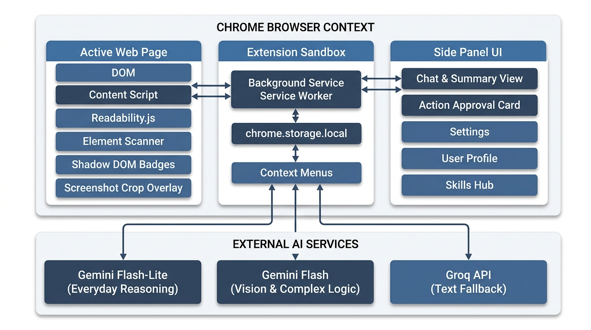
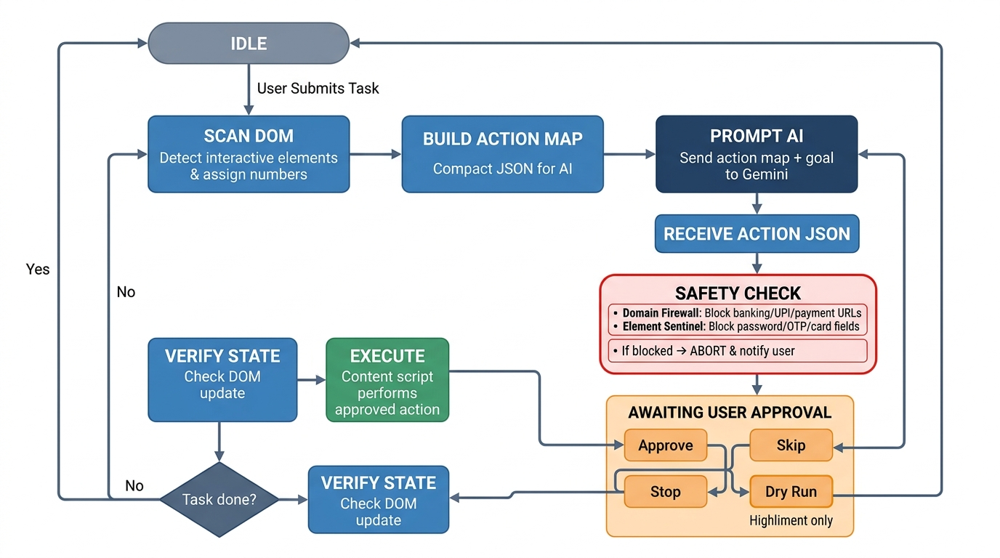
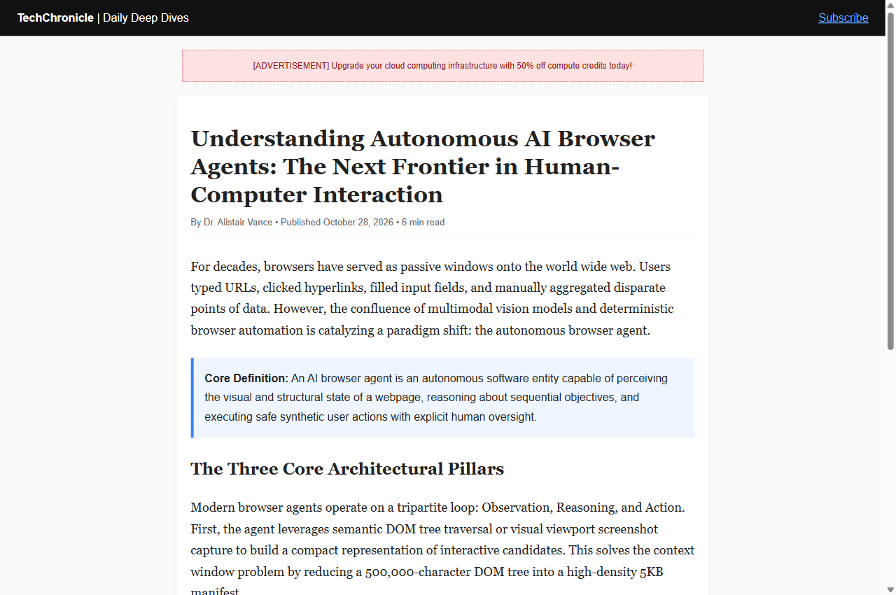
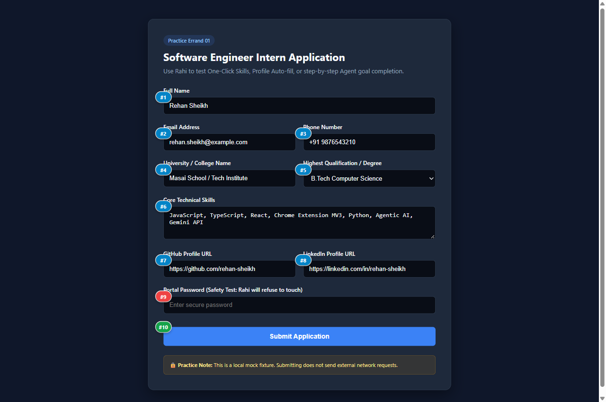
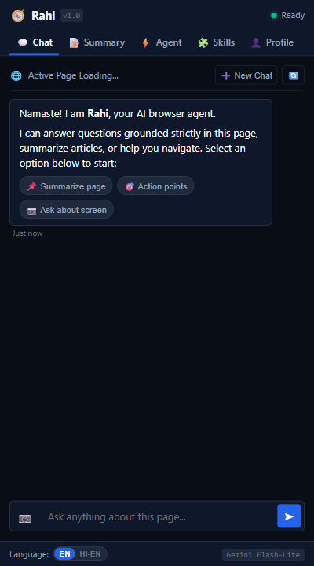
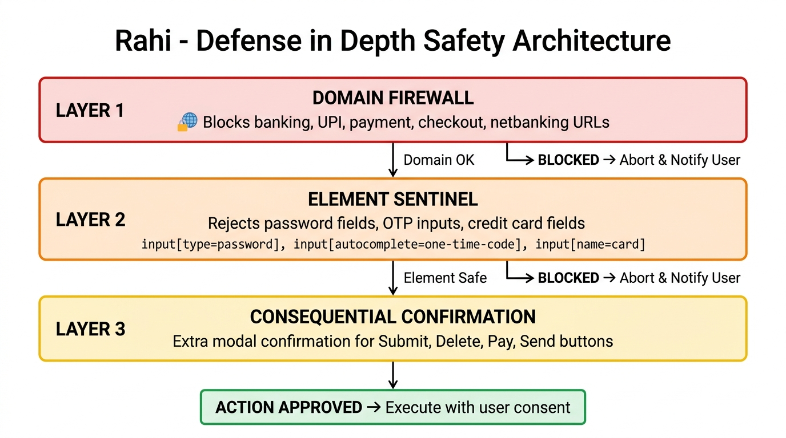
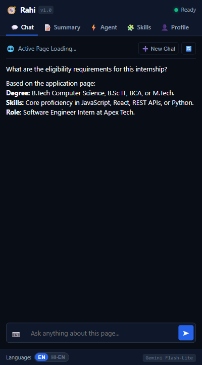

<div align="center">

# 🧭 Rahi — Autonomous AI Web Browser Agent
### A Privacy-First, Human-in-the-Loop Chrome Side-Panel AI Agent Built for the Modern Web

[](https://developer.chrome.com/docs/extensions/mv3/)
[](https://aistudio.google.com/)
[](https://groq.com/)
[-10B981?style=for-the-badge&logo=node.js&logoColor=white)](package.json)
[](LICENSE)

<br/>


<br/>

**Rahi** (*Hindi for Guide / Traveler*) transforms Google Chrome into an autonomous web assistant that **observes**, **understands**, **reasons**, and **acts** on web pages with strict human consent and zero credential leakage.

[Explore Architecture](#-system-architecture) • [Core Capabilities](#-the-five-architectural-pillars) • [Practice Errands](#-practice-errand-environments) • [Quickstart Guide](#-quickstart-guide) • [Test Suite](#-automated-testing-suite)

</div>

---

## 📌 Executive Summary

Traditional web automation bots and cloud-based AI scrapers suffer from three critical flaws:
1. **Security & Privacy Risks:** Requiring users to hand over plain-text passwords or cloud cookies.
2. **Brittle Selectors & Broken Frameworks:** Failing silently when interacting with controlled React or Vue inputs.
3. **Unchecked Autonomy:** Submitting irreversible payments or data without explicit human oversight.

**Rahi** solves these foundational problems through a strict **human-in-the-loop, client-side architecture** built for Chrome Manifest V3 (Chrome 116+):

- **👀 High-Fidelity Extraction:** Mozilla Readability article parsing, YouTube timestamp chapter extraction, and high-DPI Drag-to-Crop viewport vision.
- **🧠 Zero-Hallucination Grounded Chat:** Strict context containment preventing fabricated answers, with instant English <-> Hinglish bilingual switching.
- **✋ Interactive Shadow DOM Badges:** Visual numbered pills (`#1`, `#2`, `#3`...) rendered directly over actionable candidates inside an isolated `#rahi-badge-root` Shadow DOM container.
- **🛡️ 3-Layer Defense-in-Depth (ADR-003):** Domain Firewall blocking financial/auth portals, Sensitive Element Sentinel refusing to touch passwords/OTPs/cards, and Consequential Action secondary consent gates.
- **👤 Local Profile Memory & One-Click Skills Hub (`rahi-skills-v1`):** On-device profile memory to auto-fill multi-field applications, plus custom JSON prompt recipe import/export with strict sanitization.
- **⚡ Dual-Engine Failover Resilience:** Transparent automatic failover to Groq Llama 3.3 70B with exponential backoff and jitter whenever Google Gemini free-tier rate limits (HTTP 429) are encountered.

---

## 🏛️ System Architecture

Rahi is architected around isolated execution contexts conforming to Chrome Extension Manifest V3 security boundaries:

<div align="center">
  
</div>

### Architectural Highlights

1. **Native Chrome Side Panel API (`chrome.sidePanel`):** Persistent, non-intrusive workspace running alongside active web pages without pop-up auto-close issues.
2. **Dual-World Content Pipeline:** Content scripts run in an isolated world with clean IIFE wrapping, communicating with the Side Panel via runtime messaging and dynamic execution bridges (`chrome.scripting.executeScript`).
3. **Isolated Shadow DOM Overlay:** Injected badges and visual bounding rings exist within a dedicated Shadow DOM root (`#rahi-badge-root`), eliminating CSS bleed both into the host page and from the host stylesheet.
4. **Client-Side Storage Isolation:** All API keys, user profile memory, and session histories are stored exclusively in `chrome.storage.local` with zero telemetry or third-party server relay.

---

## 🤖 The Agent State Machine

When a user initiates an autonomous goal (e.g., *"Find and apply to this job"*, *"Search catalog for wireless headphones under \$100"*), Rahi executes a deterministic, multi-turn state loop:

<div align="center">
  
</div>

1. **Scan & Compact:** Scans interactive elements (`a[href]`, `button`, `input`, `select`), computes accessible labels (`aria-label`, `<label for>`, placeholder), and creates an ultra-compact JSON manifest.
2. **Safety Firewall Pre-Check:** Layer 1 verifies active URL against restricted banking/auth domains; Layer 2 filters sensitive password/OTP nodes.
3. **Dual-Engine Reasoning:** Gemini Flash-Lite evaluates current DOM candidates against previous history and goal objectives, returning structured action decisions.
4. **Schema Validation:** `schema_validator.js` enforces strict JSON schema (`targetId`, `action`, `value`, `reason`, `isConsequential`).
5. **Human Approval Card:** Action is presented with **Approve**, **Dry Run** (highlights target without firing), **Skip**, and **Stop** buttons.
6. **Synthetic Event Execution:** Bypasses modern framework synthetic event suppression (React 16+ controlled component hack) via native prototype descriptor setters and complete pointer/mouse event sequences.

---

## 🌟 The Five Architectural Pillars

### Pillar 1: The Eyes (Observation & Visual Understanding)
- **Mozilla Readability Extraction:** Strips ads, widgets, tracking scripts, and sidebars, delivering clean article prose for summarization.
- **YouTube Native Summarizer:** Extracts creator chapters and descriptions to generate timestamped deep links (`t=MMmSSs`) that jump to video moments.
- **Drag-to-Crop Screenshot Tool:** Crop complex charts, architecture diagrams, or UI elements on-demand for multimodal vision reasoning via Gemini.

<div align="center">
  
  
</div>

---

### Pillar 2: The Brain (Grounded Chat & Multimodal Reasoning)
- **Zero Hallucinations:** Enforces strict context boundaries—if a requested fact is not present in the active DOM or extracted article, Rahi explicitly states: *"I cannot find that information on the current page."*
- **Sliding Window History:** Caps conversational history to the last 20 messages, preserving tokens and preventing compaction degradation.
- **Bilingual Hinglish Toggle:** Switch on-the-fly between standard English and conversational Romanized Hinglish.

<div align="center">
  
</div>

---

### Pillar 3: The Hands (Action Agent with Human Approval)
- **Isolated Shadow DOM Badges:** Visual badges (`#1`, `#2`, `#3`...) numbered sequentially and overlaid over all actionable elements.
- **"Find It for Me" Pulse Locator:** Type what you're looking for (e.g. *"Pricing button"*, *"Career links"*); Rahi scrolls to the element and triggers a high-visibility pulsing golden ring.
- **React Controlled Component Setter Hack:** Directly invokes native property setters:
  ```javascript
  const setter = Object.getOwnPropertyDescriptor(window.HTMLInputElement.prototype, 'value')?.set;
  setter.call(element, textValue);
  element.dispatchEvent(new Event('input', { bubbles: true, composed: true }));
  element.dispatchEvent(new Event('change', { bubbles: true, composed: true }));
  ```

<div align="center">
  
  
</div>

---

### Pillar 4: Hardcoded Defense-in-Depth (ADR-003)

Rahi enforces three non-bypassable security layers directly inside code, guaranteeing agent autonomy never compromises user safety:

<div align="center">
  
</div>

| Defense Layer | Scope | Trigger / Enforcement Policy |
| :--- | :--- | :--- |
| **Layer 1: Domain Firewall** | URL Level | Disables agent tasks on financial portals, netbanking, payment gateways (`paypal`, `stripe`, `razorpay`), and authentication endpoints (`accounts.google.com/signin`, `login.microsoftonline.com`). |
| **Layer 2: Element Sentinel** | DOM Node Level | Prohibits synthetic events on `input[type="password"]`, OTP fields (`autocomplete*="one-time-code"`, `id*="otp"`), and credit card numbers/CVVs (`autocomplete*="cc-"`). Refusal is displayed in UI and log. |
| **Layer 3: Consequential Consent** | Action Level | Operations that commit data (`submit`, `delete`, `pay`, `purchase`, `remove`, `buy`) lock the Approve button until the user explicitly marks the secondary confirmation checkbox. |

---

### Pillar 5: Local Profile Memory & One-Click Skills Hub (`rahi-skills-v1`)
- **Zero-Leakage Profile Memory:** Stores applicant data (`fullName`, `email`, `phone`, `college`, `degree`, `skills`, `github`, `linkedin`, `portfolio`) purely in local storage.
- **Semantic Field Matcher:** Intelligently maps stored profile fields to varying web forms via regex heuristics.
- **Built-in Skills Catalog:**
  1. 📚 **Exam High-Yield Notes:** Generates definitions, formulas, and study questions.
  2. 🗣️ **Explain in Hinglish:** Demystifies complex concepts using natural Hinglish.
  3. ✉️ **Draft Polite Reply:** Contextual email and comment drafting based on selected tone.
  4. 📝 **Auto-Fill Form from Profile:** Generates sequential form-filling tasks from profile memory.
  5. 🎯 **Action Points & Deadlines:** Extracts dates, deliverables, and checklist items.
- **Custom Skill Creator & Export/Import:** Export recipes to `rahi-skills-YYYY-MM-DD.json` with `<50KB` size boundaries and XSS/script sanitization.

<div align="center">
  
  
</div>

---

## 🧪 Practice Errand Environments

Rahi includes self-contained mock web environments in `test/fixtures/` allowing you to test, demonstrate, and grade every agent capability completely offline without external network dependencies:

| Environment | Purpose & Workflows Tested | Local Endpoint |
| :--- | :--- | :--- |
| **Internship Application Form** | Full profile auto-fill, degree selects, password sentinel blocking, consequential submit consent. | `http://localhost:3000/form` |
| **E-Commerce Catalog** | Search bar typing, category checkbox toggling, price sorting, and cart buttons. | `http://localhost:3000/catalog` |
| **Editorial Tech Article** | Mozilla Readability parsing, noise and banner ad stripping, grounded Q&A verification. | `http://localhost:3000/article` |
| **Showcase Landing Page** | High-contrast presentation site highlighting system features, architecture, and quickstart. | `http://localhost:3000/landing` |

To start the practice server:
```powershell
npm run serve
```

---

## 🚀 Quickstart Guide

### 1. Prerequisites
- Google Chrome browser (v116+ with Side Panel support).
- A free **Google Gemini API Key** from [Google AI Studio](https://aistudio.google.com/).
- *(Optional)* A free **Groq API Key** from [Groq Console](https://console.groq.com/) for zero-downtime failover.

### 2. Load Extension in Chrome
1. Clone this repository:
   ```bash
   git clone https://github.com/rehan-sheikh/rahi-ai-browser-agent.git
   cd rahi-ai-browser-agent
   ```
2. Open Google Chrome and go to `chrome://extensions`.
3. Enable **Developer mode** (toggle in the top-right corner).
4. Click **Load unpacked** and select the cloned project folder.
5. Click the puzzle icon in Chrome toolbar and pin **Rahi**.

### 3. Configure API Keys
1. Click the **Rahi** icon to open the Side Panel.
2. Navigate to the **⚙️ Settings** tab.
3. Paste your Gemini API key (and optional Groq key).
4. Click **Test API Key** to verify connectivity, then click **Save Settings**.

---

## 🔬 Automated Testing Suite

Rahi includes a comprehensive unit testing suite with **zero external runtime dependencies** (pure Node.js test runner):

```powershell
npm test
```

### 16/16 Test Suites Passing (66 Unit Tests):

```text
> rahi-ai-browser-agent@1.0.0 test
> node test/unit/ai_gateway.test.js && node test/unit/summary.test.js && ...

Testing ai_gateway.js...                          ✅ 4/4 passed
Testing summary parser and extraction logic...   ✅ 10/10 passed
Testing Grounded Page Chat & Streaming Logic...   ✅ 7/7 passed
Testing Context Menu Action Dispatcher...         ✅ 5/5 passed
Testing Screenshot Drag-to-Crop & Visual Logic... ✅ 4/4 passed
Testing Free-Tier Resilience & Failover...        ✅ 5/5 passed
Testing Interactive Element Scanner...            ✅ 4/4 passed
Testing Shadow DOM Numbered Badges Overlay...     ✅ 4/4 passed
Testing Action Decision Schema Validator...       ✅ 4/4 passed
Testing Synthetic Event Executor...               ✅ 6/6 passed
Testing "Find It for Me" Element Locator...       ✅ 3/3 passed
Testing Agent Approval Controller...              ✅ 2/2 passed
Testing Local User Profile Memory...              ✅ 3/3 passed
Testing One-Click Skills Hub & Export/Import...   ✅ 5/5 passed
Testing Hardcoded Security Guardrails...          ✅ 3/3 passed
Testing Practice Errand Fixtures...               ✅ 3/3 passed

Total: 16/16 test suites, 66/66 unit tests passed successfully! (100% green)
```

---

## 📦 Production Release Packaging

Generate an audited, sanitized `.zip` archive ready for upload to the Chrome Web Store or GitHub Releases:

```powershell
npm run package
```

- **Output:** `dist/rahi-extension-v1.0.0.zip` (107 KB)
- **Integrity Check:** Validated against Manifest V3 guidelines with zero `.env` or development files included.

---

## 📑 Architectural Decision Records (ADRs)

| ADR ID | Decision Title | Architectural Choice & Rationale |
| :--- | :--- | :--- |
| **ADR-001** | Chrome Side Panel over Browser Action Popup | Popup closes on outside click, destroying agent execution loops. Side Panel maintains state persistently across tab interactions. |
| **ADR-002** | Dual-Engine LLM Gateway with Groq Failover | Google Gemini free-tier imposes 15 RPM limits. Transparent failover to Groq Llama 3.3 70B guarantees zero-downtime availability. |
| **ADR-003** | 3-Layer Defense-in-Depth Security Model | Eliminates autonomous credential theft and unintended monetary transactions via hardcoded Domain Firewall, Node Sentinel, and Consent Gates. |
| **ADR-004** | Shadow DOM Root for In-Tab Badges | Prevents host website CSS from breaking badge styling and extension styles from altering page layout. |
| **ADR-005** | Grounded Context Containment Heuristic | Strict refusal prompt directive prevents hallucinations when active page content does not contain requested facts. |
| **ADR-006** | Canvas Crop Normalizer with Retina Scaling | Normalizes bounding coordinates in all drag directions and multiplies by `devicePixelRatio` to prevent blurred crops on high-DPI screens. |
| **ADR-007** | Native Prototype Setter Hack for Controlled Inputs | Overcomes synthetic event suppression in React 16+ and Vue by invoking `HTMLInputElement.prototype` setters before dispatching `input` events. |

---

## 👤 Author & Acknowledgments

- **Author:** Rehan Sheikh
- **Course:** Masai Live Project Course (Masai October Project)
- **License:** Open source under the [MIT License](LICENSE)
