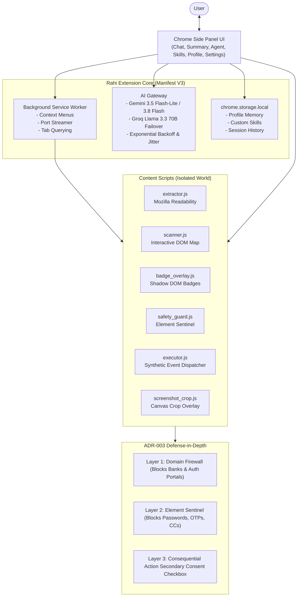

# 🧭 Rahi — AI Web Browser Agent

> **An autonomous, human-in-the-loop Chrome Side-Panel AI Agent built on Manifest V3, Google Gemini, and Groq.**
> Observe, understand, reason, and act on the web with complete privacy and safety.

[](https://developer.chrome.com/docs/extensions/mv3/)
[](package.json)
[](lib/safety_guard.js)
[](LICENSE)

---

## 🌟 Overview

**Rahi** (Hindi for *Guide / Traveler*) transforms your Chrome browser into an intelligent, co-piloting companion. Operating directly from the native Chrome Side Panel, Rahi:
1. **👀 Observes:** Extracts structured article text using Mozilla Readability and captures visual viewport regions with Drag-to-Crop Screenshot analysis.
2. **🧠 Reasons:** Grounded Q&A (no hallucinations), YouTube video summarization with deep clickable timestamps, and bilingual English / Romanized Hinglish explanations.
3. **✋ Acts With Human Approval:** Scans interactive elements, overlays isolated Shadow DOM numbered badges, and proposes sequential browser actions (`click`, `type`, `select`, `scroll`) through an approval card with Dry Run safety.
4. **🛡️ Protects:** Hardcoded 3-layer security guardrails (Domain Firewall, Sensitive Element Sentinel for passwords/OTPs/cards, and Consequential Confirmation Gates).
5. **👤 Remembers Locally:** Privacy-first User Profile Memory stored on-device to auto-fill repetitive job applications and forms via the One-Click Skills Hub (`rahi-skills-v1`).

---

## 🏛️ System Architecture



---

## 🚀 Features Breakdown

### 1. Page & YouTube Summarizer
- **Article Reader:** Strips ads, navbars, and noise using Mozilla Readability with paywall heuristic detection.
- **YouTube Video Summarizer:** Extracts public creator timestamps and chapters, generating timestamped deep links (`t=MMmSSs`).
- **Hinglish Toggle:** Switch seamlessly between professional English and conversational Hinglish.

### 2. Grounded Page Chat & Vision
- **Zero Hallucinations:** Strict context containment refuses to answer questions not supported by active page content.
- **Drag-to-Crop Screenshot:** Crop any chart, diagram, or UI element and query Gemini Vision with high-DPI scaling and black-frame DRM detection.
- **Selection Context Menus:** Right-click any text for instant *Explain Selection*, *Translate to Hinglish*, or *Draft Polite Reply*.

### 3. The Hands: Action Agent & "Find It for Me"
- **Shadow DOM Badges:** Renders numbered badges over buttons, links, and inputs using `#rahi-badge-root` with zero style leakage.
- **"Find It for Me":** Ask natural language questions like *"Where is the apply button?"* and Rahi smoothly scrolls to and pulse-highlights the target.
- **Human-in-the-Loop Approval:** Every action proposes a step with **Approve**, **Dry Run** (highlights without clicking), **Skip**, and **Stop** controls. Enforces a maximum 15-step safety ceiling.

### 4. Memory & One-Click Skills Hub (`rahi-skills-v1`)
- **Built-in Recipes:**
  - 🎓 *Exam High-Yield Notes:* Study summaries and practice questions.
  - 🇮🇳 *Explain in Hinglish:* Conceptual breakdown with analogies.
  - ✉️ *Draft Polite Reply:* Contextual email & comment drafting.
  - 📝 *Auto-Fill Form from Profile:* Maps saved local profile attributes to page inputs.
  - 🎯 *Action Points & Deadlines:* Action item checklists.
- **Custom Skill Builder:** Create, edit, and delete custom prompt recipes.
- **Secure Export / Import:** Export skills to `rahi-skills.json` and safely import recipes with `<50KB` size limits and script injection sanitization.

### 5. Multi-Layer Security Guardrails
- **Domain Firewall:** Unconditionally disables agent actions on banking domains (HDFC, SBI, ICICI, Chase, etc.), payment portals (PayPal, Stripe, Razorpay), and authentication gateways (`accounts.google.com/signin`, `login.live.com`).
- **Element Sentinel:** Refuses to interact with `input[type="password"]`, OTP inputs (`autocomplete="one-time-code"`), and payment fields (`cc-number`, `cvv`).
- **Consequential Checkbox:** Secondary confirmation required for consequential actions (`submit`, `delete`, `pay`, `purchase`, `order`).

---

## 🛠️ Installation & Setup

### Prerequisites
- Google Chrome browser (v116+ with Side Panel API support).
- A free **Google Gemini API Key** from [Google AI Studio](https://aistudio.google.com/).
- *(Optional)* A free **Groq API Key** from [Groq Console](https://console.groq.com/) for automatic rate-limit failover.

### Step-by-Step Installation
1. Clone this repository:
   ```bash
   git clone https://github.com/rehansheikh/rahi-ai-browser-agent.git
   cd rahi-ai-browser-agent
   ```
2. Open Chrome and navigate to:
   ```text
   chrome://extensions
   ```
3. Enable **Developer mode** using the toggle switch in the top-right corner.
4. Click **Load unpacked** and select the `rahi-ai-browser-agent` project directory.
5. Click the **Extensions puzzle icon** in your Chrome toolbar and pin **Rahi**.
6. Click the **Rahi** icon to open the Side Panel.
7. Go to the **⚙️ Settings** tab, paste your **Gemini API Key**, and click **Save Settings**. Click **Test Key** to verify connectivity.

---

## 🧪 Testing & Verification

Run the comprehensive unit test suite:
```bash
npm test
```

### Test Suites Included (15/15 passing):
- `ai_gateway.test.js`: Request conditioning, key validation, and prompt formatting.
- `summary.test.js`: Markdown parsing, paywall detection, and YouTube timestamp deep links.
- `chat.test.js`: Context containment, refusal string check, and SSE stream parser.
- `context_menus.test.js`: Prompt builders for Explain, Translate, and Draft Reply.
- `screenshot.test.js`: Coordinate normalization, high-DPI scaling, and DRM black-frame detection.
- `resilience.test.js`: Exponential backoff delay with jitter and Groq failover.
- `scanner.test.js`: Accessible label resolution hierarchy and action manifest compactor.
- `badge_overlay.test.js`: Shadow DOM badge creation and pulse animations.
- `schema_validator.test.js`: Deterministic JSON schema and consequential keyword detection.
- `executor.test.js`: Synthetic click, React input prototype setter hack, and scroll execution.
- `find_it.test.js`: Element locator prompt construction and response parsing.
- `approval.test.js`: Human-in-the-loop state machine and step progression.
- `profile.test.js`: Profile sanitization and semantic form field matcher.
- `skills.test.js`: One-Click Skills catalog, custom skill validation, and JSON import/export.
- `safety_guard.test.js`: 3-layer security guardrails (Domain Firewall & Element Sentinel).

---

## 📂 Practice Errand Environments

Self-contained mock web pages are included in `test/fixtures/` to test agent workflows offline:
- [mock_internship_form.html](test/fixtures/mock_internship_form.html): Test profile auto-fill and password sentinel blocks.
- [mock_product_catalog.html](test/fixtures/mock_product_catalog.html): Test search filtering, sort selects, and cart buttons.
- [mock_article.html](test/fixtures/mock_article.html): Test Mozilla Readability parsing, ad stripping, and summarization.

---

## 📄 License
This project is licensed under the [MIT License](LICENSE).

