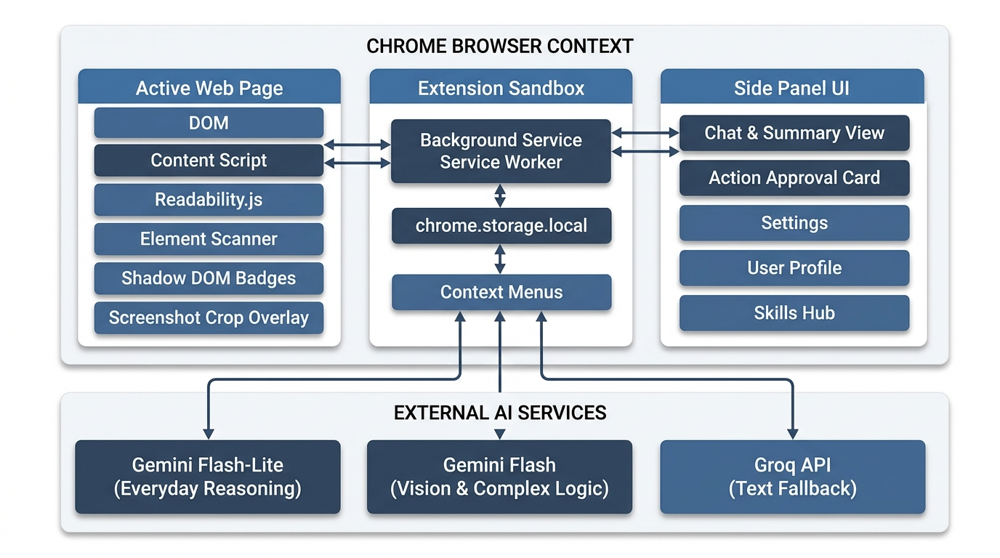
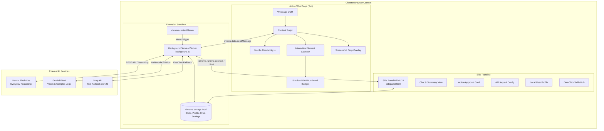
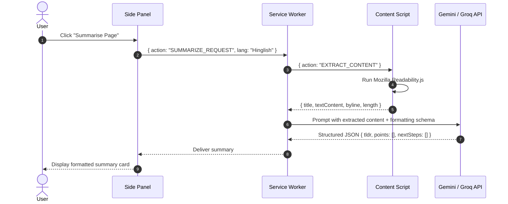
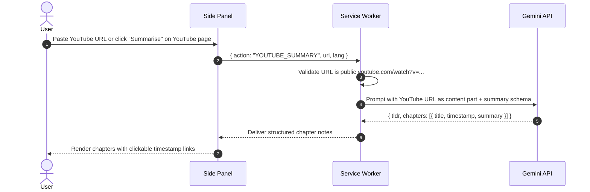
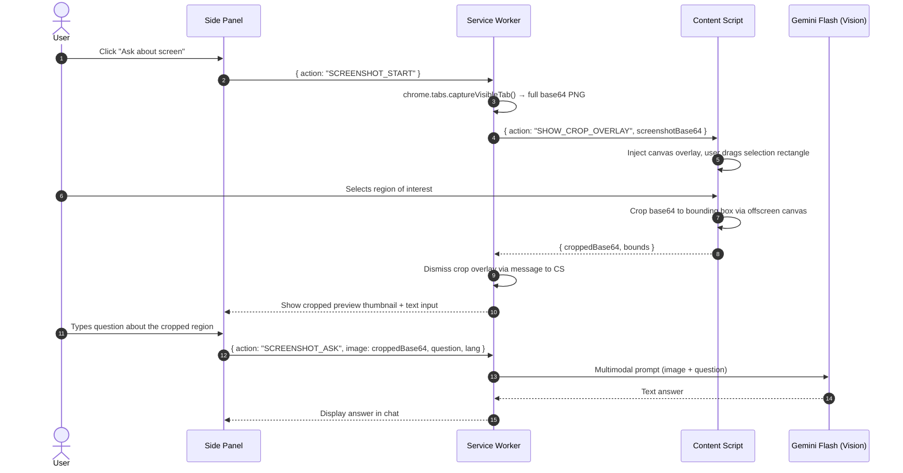
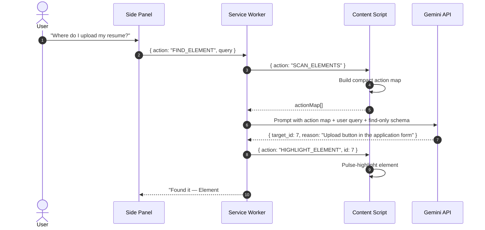
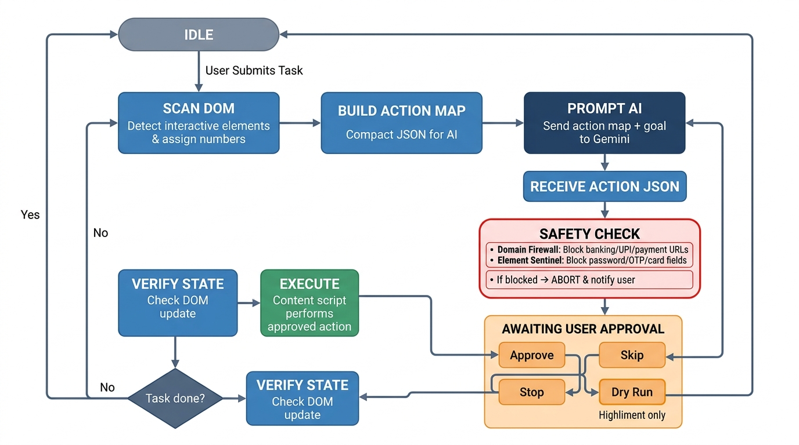
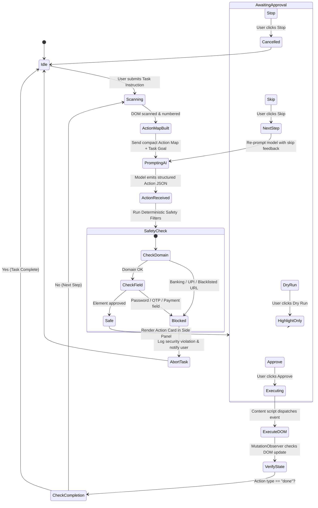
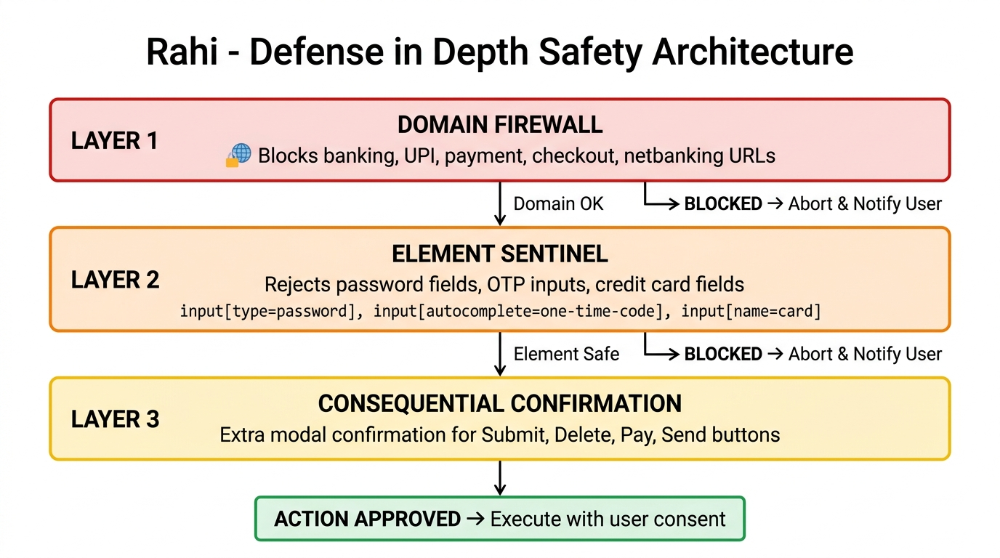

# Architecture Specification: Rahi AI Web Browser Agent

> **Status:** Accepted  
> **Target Version:** Manifest V3 (Chrome 116+)  
> **Reference:** [problemstatement.md](file:///d:/My%20Projects/Massai%20Live%20Project%20Course/Masai%20October%20Project/Ai%20Web%20Browser/problemstatement.md)

---

## 1. System Overview & Philosophy

**Rahi** is a user-controlled Chrome Side-Panel AI Agent built to observe, understand, reason, and act within the user's active browser viewport without ever compromising user agency or security.

### Core Principles
1. **Human-in-the-Loop by Design (HITL):** Rahi never takes autonomous destructive or mutation actions. Every DOM click, keyboard input, or form submission requires explicit user inspection and approval (`Approve`, `Skip`, `Stop`).
2. **Deterministic Safety over Model Self-Policing:** The browser extension enforces strict security guardrails (blocking banking pages, password fields, OTPs) directly in deterministic JavaScript before any LLM prompt is constructed or action is triggered.
3. **Resilient Service-Worker Lifecycles:** Chrome Manifest V3 service workers terminate after short periods of inactivity. All long-running agent tasks persist state machine snapshots into `chrome.storage.local` to survive background sleep cycles.
4. **Free-Tier Sustainability & Graceful Degradation:** Optimized token budgets using compact action maps rather than raw HTML; multi-tiered provider failover (Gemini Flash-Lite → Gemini Flash → Groq free tier) with exponential backoff on HTTP 429.

---

## 2. High-Level Architecture Diagram





---

## 3. Component Architecture & Responsibilities

### 3.1 Side Panel UI (`sidepanel/`)
- **Technology:** Pure HTML5, Modern CSS, Vanilla ES6 Modules.
- **Design Direction:** Compact, information-dense productivity layout. Neutral tone palette (slate/zinc grays, muted blue accents) optimized for readability beside busy web pages. No decorative effects — every pixel serves a functional purpose. Inspired by browser DevTools density, not marketing landing pages.
- **Responsibilities:**
  - Chat interface with streaming responses and markdown rendering.
  - Summarization viewer (TL;DR, 5 key points, actionable next steps).
  - Language toggle (`English` ↔ `Hinglish`).
  - **Action Approval Card:** Visual preview of pending action, target element index, human-readable rationale, and action controls (`Approve`, `Skip`, `Stop`, `Dry Run`).
  - Action execution history log.
  - User Profile settings & Saved One-Click Skills import/export.
  - API Key and Model configuration management.

### 3.2 Background Service Worker (`background/service_worker.js`)
- **Technology:** Chrome Extension MV3 Service Worker.
- **Responsibilities:**
  - Manages extension lifecycle and side panel state (`chrome.sidePanel.setPanelBehavior`).
  - Coordinates inter-context messaging between Side Panel and Content Scripts.
  - Registers context menus (`chrome.contextMenus.create` for *Explain*, *Translate*, *Draft Reply*).
  - Handles visual capture (`chrome.tabs.captureVisibleTab`) for screenshot questions.
  - Coordinates LLM API calls, rate-limit retries, and fallback dispatch.
  - Manages task state machine hydration and rehydration from `chrome.storage.local`.
  - **Streaming:** Uses `chrome.runtime.connect()` to establish a long-lived message port with the side panel during streaming API calls. SSE/chunked response tokens are forwarded as individual port messages. The port is disconnected on stream completion or error, allowing the service worker to sleep normally.

### 3.3 Content Script & Page Injector (`content/`)
- **Technology:** Isolated World Content Script with Shadow DOM overlay.
- **Modules:**
  - **`extractor.js`:** Integrates Mozilla Readability.js to strip navbars, ads, footers, and scripts, returning structured article title and clean text.
  - **`scanner.js`:** Traverses the DOM for interactive elements (`<button>`, `<a>`, `<input>`, `<textarea>`, `<select>`, `[role="button"]`, etc.), computes bounding boxes, filters visible elements, and assigns stable sequential integer IDs (`1, 2, 3...`).
  - **`badge_overlay.js`:** Renders numbered badges over scanned elements using an isolated **Shadow DOM root** (`#rahi-badge-root`) so page styles do not corrupt badges and extension styles do not bleed into the host page.
  - **`screenshot_crop.js`:** Injects a temporary full-viewport canvas overlay with drag-to-select region cropping. On selection, crops the captured `captureVisibleTab` base64 image to the selected bounding box using an offscreen `<canvas>`, returns the cropped base64 to the service worker, and auto-dismisses the overlay.
  - **`executor.js`:** Deterministically executes approved actions (`click()`, simulated human typing with synthetic `InputEvent`, select change, scroll) with pre-execution safety validation.
  - **`safety_guard.js`:** Hardcoded client-side security validator that intercepts target elements and blocks disallowed inputs before any execution can occur.

---

## 4. Subsystem Deep Dives

### 4.1 Content Extraction & Summarization Pipeline


### 4.2 YouTube Summarization Pipeline

**Approach:** Gemini natively accepts public YouTube URLs as input context. Rahi passes the URL directly to the Gemini Flash-Lite API without needing a separate transcript extraction step.



**Key decisions:**
- **Timestamps rendered as deep links:** Each chapter timestamp is rendered as `<a href="https://youtube.com/watch?v=VIDEO_ID&t=SECONDSs">MM:SS</a>`. Clicking opens or navigates the YouTube tab to that moment.
- **Fallback:** If Gemini cannot process the video (private, age-restricted, too long), Rahi shows a clear error: *"This video is not supported for summarization. It may be private or restricted."*
- **No separate transcript API needed:** Avoids YouTube Data API quota issues by leveraging Gemini's native URL understanding.

### 4.3 Screenshot-and-Ask Pipeline



**Key decisions:**
- **Crop overlay is temporary:** Injected into the content script's isolated world, auto-dismissed after selection or on Escape key press.
- **Vision model used:** Screenshot questions always route to Gemini Flash (not Flash-Lite), since multimodal vision requires the stronger model tier.
- **Full-screen fallback:** If the user presses Enter without selecting a region, the full uncropped screenshot is sent with the question.

### 4.4 Grounded Page Chat & Conversation History

**Grounding Strategy:**

Page chat uses a structured system prompt that injects extracted page content as a `[CONTEXT]` block. The model is constrained to answer only from this context:

```
System Prompt Template:
─────────────────────────
You are Rahi, a browser assistant. Answer the user's question using ONLY 
the page content provided below. 

Rules:
1. If the answer exists in the context, provide it with a brief quote.
2. If the answer is NOT in the context, respond exactly: 
   "I couldn't find that information on this page."
3. Never invent, assume, or use external knowledge.
4. Respond in {language: English | Hinglish} as configured.

[PAGE CONTEXT]
Title: {extracted_title}
URL: {current_url}
Content:
{readability_extracted_text}
[END CONTEXT]
```

**Conversation History Management:**
- History is **scoped per tab + URL combination**. Navigating to a new URL within the same tab clears the chat history (because the page context has changed).
- A **sliding window** retains the last 20 message pairs (user + assistant). When the window is exceeded, the oldest messages are dropped.
- History is stored in `chrome.storage.local` under the `chatSessions` key (see Section 6) and survives service worker sleep.
- On tab close, the corresponding chat session is garbage-collected.

### 4.5 "Find It for Me" Flow

This is a **query-only flow** that is architecturally distinct from the full agent loop. It scans interactive elements and asks the model to identify the best match, but **never enters the execution path**.



**Key difference from agent loop:** The model output schema for "Find It" omits the `action` field entirely and only returns `{ target_id, reason }`. There is no approval card, no execution step. The content script highlights the element with a pulsing border animation and scrolls it into view.

### 4.6 Interactive Action Loop (The Hands)




### 4.7 Action Map Protocol (Compact AI Representation)
To minimize token consumption and maximize latency efficiency on free-tier LLMs, raw HTML is never sent to the model. Instead, `scanner.js` converts visible elements into a compact JSON manifest:

```json
[
  { "id": 1, "type": "input_text", "label": "Full Name", "placeholder": "Enter your name", "value": "" },
  { "id": 2, "type": "input_email", "label": "College Email", "placeholder": "student@univ.edu", "value": "" },
  { "id": 3, "type": "select", "label": "Degree", "options": ["B.Tech", "B.Sc", "M.Tech"], "selected": "B.Tech" },
  { "id": 4, "type": "button", "label": "Submit Application", "classes": "btn-primary" }
]
```

### 4.8 Model Decision Schema (Strict JSON Output)
Every action proposed by the LLM must validate against this strict schema:

```json
{
  "type": "object",
  "properties": {
    "action": {
      "type": "string",
      "enum": ["click", "type", "select", "scroll", "done", "ask_user"]
    },
    "target_id": {
      "type": "integer",
      "description": "ID of the target element from the action map"
    },
    "value": {
      "type": "string",
      "description": "Text to type or option value to select"
    },
    "reason": {
      "type": "string",
      "description": "Short, clear one-sentence explanation in English or Hinglish"
    },
    "is_consequential": {
      "type": "boolean",
      "description": "True if action submits form, deletes data, or navigates away"
    }
  },
  "required": ["action", "reason", "is_consequential"]
}
```

---

## 5. Security & Safety Architecture



### 5.1 Defense in Depth
Safety is implemented across three distinct layers:

```
[ Layer 1: Domain Firewall ] → Blocks URLs matching banking, UPI, payment, or auth portals.
         ↓
[ Layer 2: Element Sentinel ] → Rejects inputs with type=password, autocomplete=one-time-code, cc-* fields.
         ↓
[ Layer 3: Consequential Confirmation ] → Extra modal confirmation required for Submit, Delete, Pay, Send.
```

### 5.2 Deterministic Safety Rules
1. **Restricted Domain Patterns:**
   - Any URL containing `bank`, `pay`, `upi`, `checkout`, `netbanking`, `payment`, `accounts.google.com/signin`, etc.
2. **Protected Input Selectors:**
   - `input[type="password"]`
   - `input[autocomplete*="one-time-code"]`, `input[name*="otp" i]`, `input[id*="otp" i]`
   - `input[autocomplete*="cc-"]`, `input[name*="card" i]`, `input[id*="cvv" i]`
3. **API Key Isolation:**
   - Keys stored exclusively in `chrome.storage.local` (never sync storage, never checked into Git, never logged).

### 5.3 Skills Import Safety
- Imported skill files are validated against a strict JSON schema before acceptance.
- The `promptTemplate` field is sanitized to reject embedded code, script tags, or suspicious injection patterns.
- Maximum file size enforced (50 KB) to prevent abuse.

---

## 6. Data Storage & Schema Design (`chrome.storage.local`)

```typescript
interface RahiStorageSchema {
  // Settings & Credentials
  settings: {
    geminiApiKey: string;
    groqApiKey?: string;
    preferredLanguage: "en" | "hinglish";
    defaultModel: "gemini-2.5-flash-lite" | "gemini-2.5-flash";
    maxStepLimit: number;        // default: 15
    enableDryRunDefault: boolean; // default: false
  };

  // Local User Profile for Form-Fill & Drafts
  userProfile: {
    fullName: string;
    email: string;
    phone: string;
    college: string;
    degree: string;
    skills: string[];
    links: {
      github?: string;
      linkedin?: string;
      portfolio?: string;
    };
    preferredTone: "formal" | "concise" | "casual";
  };

  // Custom & Built-in Prompt Recipes
  savedSkills: Array<{
    id: string;
    name: string;
    description: string;
    promptTemplate: string;
    outputType: "summary" | "chat" | "action";
    isBuiltin: boolean;
  }>;

  // Chat History — scoped per tab+URL, sliding window of 20 pairs
  chatSessions: Record<string, {  // key = `${tabId}:${urlOriginPathname}`
    messages: Array<{
      role: "user" | "assistant";
      content: string;
      timestamp: number;
    }>;
    pageTitle: string;
    pageUrl: string;
    createdAt: number;
  }>;

  // Active Task Persistence for Worker Sleep Recovery
  activeTaskState?: {
    taskId: string;
    tabId: number;
    goal: string;
    currentStep: number;
    status: "in_progress" | "awaiting_approval" | "paused" | "completed";
    lastActionMapTimestamp: number;
    pendingAction?: {
      action: "click" | "type" | "select" | "scroll" | "done" | "ask_user";
      target_id?: number;
      value?: string;
      reason: string;
      is_consequential: boolean;
    };
    historyLog: Array<{
      step: number;
      action: string;
      reason: string;
      decision: "approved" | "skipped" | "rejected";
      timestamp: number;
    }>;
  };
}
```

### 6.1 Skills Export/Import File Format

Skills are exported as a `.json` file with the following envelope:

```json
{
  "format": "rahi-skills-v1",
  "exportedAt": "2026-10-06T20:00:00Z",
  "skills": [
    {
      "id": "skill_exam_notes",
      "name": "Exam Notes",
      "description": "Convert page content into exam-ready bullet points",
      "promptTemplate": "Summarize the following page content as concise exam notes...",
      "outputType": "summary",
      "isBuiltin": false
    }
  ]
}
```

**Import validation rules:**
1. File must parse as valid JSON and contain `format: "rahi-skills-v1"`.
2. Each skill must have all required fields (`id`, `name`, `promptTemplate`, `outputType`).
3. `promptTemplate` is sanitized: reject strings containing `<script>`, `javascript:`, `eval(`, or `Function(`.
4. Maximum file size: 50 KB.
5. Duplicate `id` values are resolved by prompting the user to overwrite or skip.
6. Built-in skills (`isBuiltin: true`) in import files are ignored — only user-created skills are importable.

---

## 7. Architecture Decision Records (ADRs)

### ADR-001: Side Panel API over Action Popup
- **Context:** Rahi needs to maintain an interactive chat interface, display action approvals, and keep logs visible while the user actively observes and interacts with the page.
- **Options Considered:** 
  1. `chrome.action` popup (closes as soon as the user clicks anywhere on the webpage).
  2. Injected iframe floating modal (collides with host page CSS/z-index, easily blocked by CSP).
  3. `chrome.sidePanel` API (persistent sidebar dock natively provided by Chrome).
- **Decision:** **Adopt `chrome.sidePanel` API.**
- **Consequences:** Provides native multi-tasking alongside the page without closing on outside clicks. Requires Chrome 116+.

### ADR-002: Shadow DOM Isolation for Badging Overlays
- **Context:** Numbered badges must overlay target interactive elements on any arbitrary website.
- **Options Considered:** 
  1. Standard DOM `<div>` injection with global CSS.
  2. Shadow DOM host element (`#rahi-badge-root`) with encapsulated styles.
- **Decision:** **Adopt closed Shadow DOM container.**
- **Consequences:** Complete style isolation; prevents host website styles (`!important`, resets, Tailwind) from breaking badge readability and guarantees extension styles do not alter the webpage.

### ADR-003: Deterministic Code Guardrails vs Prompt-Only Safety
- **Context:** An AI model might be jailbroken or hallucinate and propose clicking "Confirm Payment" or typing into an OTP field.
- **Options Considered:**
  1. System prompt instructions ("Please never interact with banking or password fields").
  2. Hardcoded deterministic JavaScript interceptors.
- **Decision:** **Adopt hardcoded deterministic code interceptors.**
- **Consequences:** Zero reliance on LLM compliance. If an element or domain is unsafe, the execution engine refuses to propose or execute the step, regardless of what the model output suggests.

### ADR-004: Dual-Engine AI Provider Strategy (Gemini Primary + Groq Fallback)
- **Context:** Free-tier rate limits (HTTP 429) can stall the user during prolonged sessions.
- **Options Considered:**
  1. Gemini only (fails when quota is exhausted).
  2. Gemini Flash-Lite as primary everyday engine + Groq free tier as instantaneous text fallback with circuit breaker.
- **Decision:** **Adopt multi-provider gateway with automatic fallback on HTTP 429.**
- **Consequences:** High availability at zero cost; requires handling slight differences in response streaming formats within the service worker adapter layer.

### ADR-005: Streaming via Long-Lived Port vs Repeated sendMessage
- **Context:** Streamed LLM responses produce many small token chunks (50-200+ messages per response). Using `chrome.runtime.sendMessage()` for each chunk creates excessive overhead and risks message ordering issues.
- **Options Considered:**
  1. `chrome.runtime.sendMessage()` per chunk (stateless, high overhead).
  2. `chrome.runtime.connect()` long-lived port (persistent channel, low overhead, ordered delivery).
- **Decision:** **Adopt `chrome.runtime.connect()` port for streaming sessions.**
- **Consequences:** The side panel opens a named port (`rahi-stream`) when a streaming request begins. The service worker pushes token chunks as port messages. On stream end or error, the port is disconnected, allowing normal service worker sleep behavior to resume.

### ADR-006: Canvas Crop Overlay for Screenshot Region Selection
- **Context:** Users need to focus screenshot questions on a specific area (a chart, an error, a form section) rather than always sending the full viewport.
- **Options Considered:**
  1. Full screenshot only — rely on user's text prompt to guide model attention.
  2. Side panel thumbnail with drag-to-crop UI.
  3. Content script canvas overlay with drag-to-select directly on the page.
- **Decision:** **Adopt content script canvas overlay with drag-to-select.**
- **Consequences:** Users select the region of interest directly on the page where they can see the actual content, rather than working with a small thumbnail in the side panel. The overlay is injected temporarily and dismissed after selection or on Escape. Requires canvas manipulation in the content script to crop the base64 image.

---

## 8. Directory & Project Structure

```
ai-web-browser/
├── .gitignore                 # Excludes API keys, node_modules, *.env, .DS_Store
├── manifest.json              # Manifest V3 configuration
├── problemstatement.md        # Core requirements & milestones
├── architecture.md            # High-level architecture & design decisions
├── implementation-plan.md     # Step-by-step phased engineering plan
├── edge-case.md               # Boundary, corner, and error handling matrix
├── icons/                     # Extension branding icons (16, 32, 48, 128)
├── sidepanel/
│   ├── sidepanel.html         # Main Side Panel container
│   ├── sidepanel.css          # Compact productivity-focused UI styling
│   ├── sidepanel.js           # UI state coordinator
│   └── components/            # Modular UI view controllers
│       ├── chat.js            # Chat view & streaming renderer
│       ├── approval.js        # Action approval card controller
│       ├── profile.js         # User profile editor
│       └── skills.js          # One-click skills management & import/export
├── background/
│   ├── service_worker.js      # Main background coordinator & lifecycle
│   ├── ai_gateway.js          # Gemini & Groq client with retry/fallback/streaming
│   └── context_menus.js       # Right-click action handler
├── content/
│   ├── content.js             # Main content script entry
│   ├── extractor.js           # Readability.js article parser
│   ├── scanner.js             # DOM element scanner & indexer
│   ├── badge_overlay.js       # Shadow DOM badge renderer
│   ├── screenshot_crop.js     # Drag-to-select region crop overlay
│   ├── executor.js            # Synthetic event dispatcher
│   └── safety_guard.js        # Hardcoded security interceptors
├── lib/
│   ├── readability.js         # Mozilla Readability bundled library
│   └── schema_validator.js    # Strict JSON action schema validator
└── landing/                   # GitHub Pages landing site
    ├── index.html
    └── style.css
```
